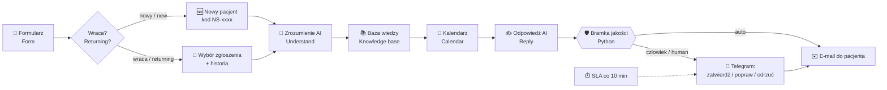

<div align="center">

# 🦷 Nova Smile · AI Support Desk PL/EN

**Dwujęzyczna (PL/EN) automatyczna obsługa pacjentów kliniki — w całości w n8n.**
**Bilingual (PL/EN) patient-support automation for a clinic — built entirely in n8n.**


*Projekt portfolio · Portfolio project — by [Phillip Mrozik](https://github.com/phillipmrozik) · MrozikDigital*

</div>

> ⚠️ **Nova Smile to fikcyjna klinika** stworzona wyłącznie na potrzeby demonstracji. Adresy, telefony, ceny i lekarze są zmyślone.
> **Nova Smile is a fictional clinic** created for demonstration only. Addresses, phone numbers, prices and doctors are made up.

---

## 🇵🇱 Po polsku

### O co chodzi?

Pacjent wypełnia formularz, a system sam:

1. **rozumie wiadomość** (język, temat, pilność, ton),
2. **szuka odpowiedzi w bazie wiedzy** kliniki (37 artykułów PL/EN: ceny, godziny, przygotowanie do zabiegów…),
3. **umawia, przekłada i odwołuje wizyty** w Kalendarzu Google (z zasadą 24 godzin),
4. **pisze odpowiedź** w języku pacjenta,
5. **sprawdza ją bramką jakości** napisaną w Pythonie,
6. **wysyła ją e-mailem** — albo, gdy sprawa jest trudna, **pyta człowieka na Telegramie**.

Założenie: **ok. 85% spraw załatwia automat, a trudne ~15% zawsze decyduje człowiek** (reklamacje, nagłe przypadki, leki i dawkowanie, pytania bez pokrycia w bazie, niska pewność).

Pacjent, który wraca, podaje e-mail i telefon, **wybiera swoje stare zgłoszenie z listy** (kody w stylu `NS-4821`) i kontynuuje rozmowę — system pamięta historię, więc „chciałbym przełożyć wizytę" jest zrozumiałe bez dodatkowych wyjaśnień.

### Najważniejsze cechy

| | |
|---|---|
| 🌍 **PL / EN** | formularze, e-maile, komunikaty, komentarze w kodzie i opisy modułów w dwóch językach |
| 🧠 **Zrozumienie wiadomości** | agent AI zwraca ściśle zdefiniowany JSON (intencja, język, pilność, ton, pewność) |
| 📚 **Prosty, przejrzysty RAG** | punktowanie artykułów (słowa kluczowe + tematy wskazane przez AI), bez „czarnej skrzynki" |
| 📅 **Silnik rezerwacji w JS** | wolne terminy pon–pt 8–20, sob 9–14, niedziela wolna; sloty 60 min; 14 dni do przodu; max 3 propozycje |
| 🛡️ **Bramka jakości w Pythonie** | 11 kontroli i punktacja ryzyka — decyduje: *wysłać automatycznie* czy *zapytać człowieka* |
| 🙋 **Człowiek w pętli** | Telegram z przyciskami: zatwierdź / popraw / odrzuć; po decyzji pacjent dostaje e-mail |
| ⏱️ **Pilnowanie czasu (SLA)** | przypomnienia, gdy sprawa czeka za długo (pilne: 10 min, zwykłe: 60 min) |
| 🚨 **Alarmy o błędach** | każdy błąd workflow trafia na Telegram |

### Jak to działa (schemat)



### Moduły (16 grup węzłów w n8n)

| # | Moduł | Co robi |
|---|---|---|
| 1 | Formularz | czyta odpowiedzi, rozdziela nowego i wracającego pacjenta |
| 2 | Wracający pacjent | weryfikuje e-mail + telefon, pokazuje listę zgłoszeń, ładuje historię |
| 3 | Nowy pacjent | zbiera dane, tworzy kod zgłoszenia |
| 4 | Zapis zgłoszenia | zapisuje zgłoszenie i wiadomość pacjenta |
| 5 | Zrozumienie (AI) i baza wiedzy | analiza wiadomości + wyszukanie artykułów |
| 6 | Kalendarz i rezerwacje | wolne terminy, rezerwacja, zmiana, odwołanie |
| 7 | Odpowiedź (AI) | pisze odpowiedź w języku pacjenta |
| 8 | Bramka jakości | kontrole bezpieczeństwa w Pythonie |
| 9 | Odpowiedź automatyczna | e-mail do pacjenta bez udziału człowieka |
| 10 | Przekazanie człowiekowi | szkic czeka na decyzję |
| 11 | Ekran końcowy | czytelne podsumowanie dla pacjenta |
| 12 | Zatwierdzanie | Telegram z decyzją zespołu |
| 13a/13b | Po zatwierdzeniu / Odrzucono | wysyłka i zamknięcie albo odnotowanie braku wysyłki |
| 14 | Pilnowanie czasu (SLA) | przypomnienia o zaległych sprawach |
| 15 | Alarmy o błędach | powiadomienia o awariach |

Szczegóły: [`docs/architecture.md`](docs/architecture.md).

### Struktura repozytorium

```
nova-smile-ai-support-desk/
├── workflow/
│   └── nova-smile-ai-support-desk.json   # workflow do zaimportowania w n8n
├── src/
│   ├── javascript/                       # węzły Code (JS) — z komentarzami PL/EN
│   ├── python/                           # bramka jakości (Python)
│   └── prompts/                          # prompty agentów AI + schematy wyników
├── data/
│   ├── knowledge_base.csv                # baza wiedzy (37 artykułów PL/EN)
│   └── knowledge_base.json
├── docs/
│   ├── architecture.md                   # architektura, tabele, decyzje projektowe
│   ├── testing.md                        # scenariusze testowe
│   └── modules.json                      # lista modułów i węzłów
├── LICENSE
└── README.md
```

### Uruchomienie krok po kroku

**Potrzebujesz:** konta n8n (Cloud lub self-hosted z Data Tables), klucza OpenAI, konta Gmail, Kalendarza Google oraz bota Telegram.

1. **Utwórz 3 tabele danych (Data Tables)** w n8n — kolumny opisane w [`docs/architecture.md`](docs/architecture.md#tabele-danych--data-tables):
   `novasmile_tickets`, `novasmile_messages`, `novasmile_knowledge`.
2. **Zaimportuj bazę wiedzy** z [`data/knowledge_base.csv`](data/knowledge_base.csv) do tabeli `novasmile_knowledge`.
3. **Zaimportuj workflow:** *Workflows → Import from file →* [`workflow/nova-smile-ai-support-desk.json`](workflow/nova-smile-ai-support-desk.json).
4. **Podepnij dane dostępowe (Credentials):** OpenAI, Gmail, Google Calendar, Telegram.
5. **Wskaż tabele** we wszystkich węzłach Data Table (w pliku stoi `REPLACE_WITH_TABLE_ID`).
6. **Uzupełnij placeholdery:**
   - `YOUR_TELEGRAM_CHAT_ID` — Twój identyfikator czatu Telegram (węzły Telegram),
   - `your.calendar@example.com` — kalendarz klinikowy (3 węzły Google Calendar),
   - `https://YOUR-N8N-HOST` — adres Twojej instancji n8n (węzeł „Ustawienia kliniki" oraz „Przekaż do zatwierdzenia").
7. **Opublikuj workflow** i otwórz adres formularza: `https://<twoja-instancja>/form/nova-smile-support`.

> 💡 Gdy nie prezentujesz projektu, wyłącz publikację — formularz jest publiczny i każde wysłanie zużywa kredyty OpenAI oraz wysyła e-mail.

### Testowanie

Gotowe scenariusze (powitanie, cena + terminy, potwierdzenie terminu, odwołanie, reklamacja, nagły przypadek, pytanie o leki, angielski) opisałem w [`docs/testing.md`](docs/testing.md).

### Czego tu nie ma (celowo)

Brak strony WWW i paneli — cały projekt to **jeden workflow n8n** i jego dane. Chciałem pokazać, że kompletną, bezpieczną obsługę klienta da się zbudować samą automatyzacją.

---

## 🇬🇧 In English

### What is it?

A patient fills in a form, and the system automatically:

1. **understands the message** (language, topic, urgency, tone),
2. **looks up the answer in the clinic's knowledge base** (37 PL/EN articles: prices, opening hours, treatment preparation…),
3. **books, reschedules and cancels appointments** in Google Calendar (with a 24-hour rule),
4. **writes a reply** in the patient's language,
5. **checks it with a quality gate** written in Python,
6. **emails it to the patient** — or, if the case is hard, **asks a human on Telegram**.

The idea: **automation handles about 85% of cases, and the tricky ~15% is always decided by a person** (complaints, emergencies, medicines and dosage, questions the knowledge base can't answer, low confidence).

A returning patient enters their e-mail and phone, **picks an earlier request from a list** (codes like `NS-4821`) and carries on — the system remembers the history, so "I'd like to move my appointment" makes sense without further explanation.

### Highlights

| | |
|---|---|
| 🌍 **PL / EN** | forms, e-mails, messages, code comments and module descriptions in two languages |
| 🧠 **Message understanding** | an AI agent returns a strictly defined JSON (intent, language, urgency, tone, confidence) |
| 📚 **Simple, transparent RAG** | article scoring (keywords + topics picked by the AI), no black box |
| 📅 **Booking engine in JS** | free slots Mon–Fri 8–20, Sat 9–14, closed Sunday; 60-min slots; 14 days ahead; max 3 proposals |
| 🛡️ **Quality gate in Python** | 11 checks and a risk score decide: *send automatically* or *ask a human* |
| 🙋 **Human in the loop** | Telegram with approve / edit / reject; the patient gets an e-mail after the decision |
| ⏱️ **Response-time watchdog (SLA)** | reminders when a case waits too long (urgent: 10 min, normal: 60 min) |
| 🚨 **Error alerts** | every workflow error is sent to Telegram |

### Modules, structure and setup

The module table and the repository tree above apply as-is. Setup in short:

1. Create the 3 **Data Tables** (`novasmile_tickets`, `novasmile_messages`, `novasmile_knowledge`) — columns in [`docs/architecture.md`](docs/architecture.md#tabele-danych--data-tables).
2. Import [`data/knowledge_base.csv`](data/knowledge_base.csv) into `novasmile_knowledge`.
3. Import [`workflow/nova-smile-ai-support-desk.json`](workflow/nova-smile-ai-support-desk.json) into n8n.
4. Attach your **credentials**: OpenAI, Gmail, Google Calendar, Telegram.
5. Point every Data Table node to your tables (`REPLACE_WITH_TABLE_ID` in the file).
6. Replace placeholders: `YOUR_TELEGRAM_CHAT_ID`, `your.calendar@example.com`, `https://YOUR-N8N-HOST`.
7. Publish the workflow and open `https://<your-instance>/form/nova-smile-support`.

> 💡 When you are not demoing the project, unpublish it — the form is public and every submission uses OpenAI credits and sends an e-mail.

### Design decisions

- **Safety first.** The AI never has the last word on sensitive topics: the Python gate blocks emergencies, complaints, medicines/dosage, prices that are not in the knowledge base, unknown phone numbers or e-mails, language mismatch and low confidence.
- **Transparent over clever.** Retrieval is a readable scoring function, not an opaque vector store — easy to explain, debug and extend.
- **Code where code is better.** Dates, slots, codes and rules are deterministic JavaScript/Python; the AI is used for understanding and wording.
- **Everything bilingual.** Node names, comments and messages are written in Polish and English.

---

## 🧰 Technologie / Tech

n8n (Form Trigger, Data Tables, AI Agent, Structured Output Parser, Google Calendar, Gmail, Telegram *send and wait*, Webhook, Schedule, Error Trigger) · OpenAI (`gpt-4.1-mini` do analizy / for analysis, `gpt-4.1` do odpowiedzi / for replies) · JavaScript · Python

## 📄 Licencja / License

[MIT](LICENSE) © Phillip Mrozik

## 📬 Kontakt / Contact

**Phillip Mrozik · MrozikDigital** — automatyzacje i integracje / automations and integrations
GitHub: [@mrozikdigital@gmail.com](https://github.com/phillipmrozik)
